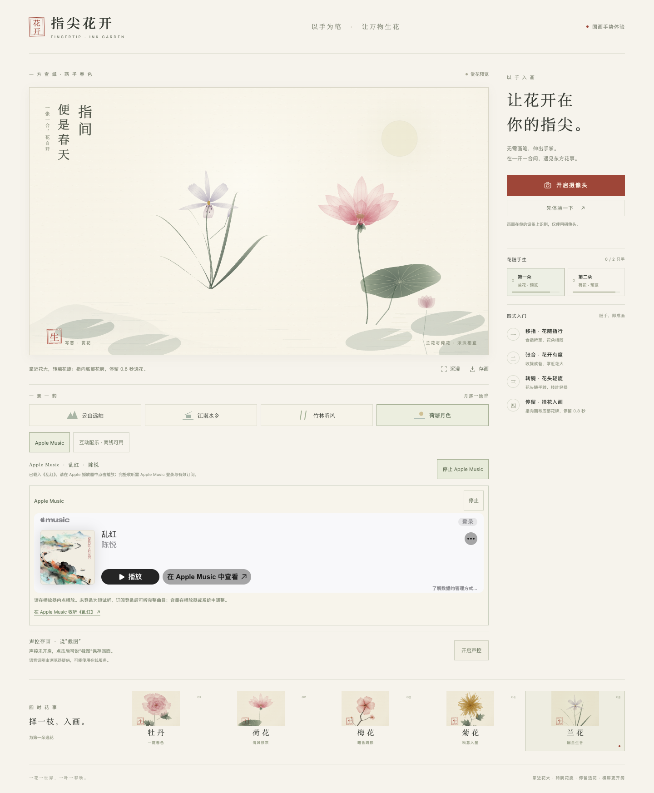

# 指尖花开 · 中国国画互动花园

以手为笔，让花开在指尖。通过摄像头识别一只或两只手，每只手对应一朵国画花卉；手指张合控制花苞到盛放，左右挥动切换各自的花型。

**[在线体验](https://fingertip-ink-garden-1105-7fa6.netlify.app)** · [完整使用说明](./使用说明.md) · [验收记录](./验收记录.md)



## 互动方式

- 一手一花，双手两花；每只手识别 21 个关键点，花心跟随食指指尖。
- 收拢成苞、舒掌盛放；先停稳，再约用 0.3–0.4 秒水平挥动，右挥下一种、左挥上一种。
- 提供牡丹、荷花、梅花、菊花、兰花，使用宣纸纹理、淡墨远山、写意枝叶、淡彩花瓣与朱印。
- 每朵花可独立选择花型；支持赏花体验、沉浸显示和 PNG 存画。
- 摄像头在浏览器本机识别，不上传视频、不请求麦克风；关闭摄像头或离开页面后释放媒体轨道。

## 本地运行

需要 Node.js 22.12 或以上的受支持版本，以及 npm。

```sh
git clone https://github.com/stevexyao/fingertip-ink-garden.git
cd fingertip-ink-garden
npm ci
npm run dev
```

浏览器打开终端显示的 `http://127.0.0.1:5186/`，点击“开启摄像头”并授权。手机请使用上面的 HTTPS 网页；普通局域网 HTTP 地址不能用于手机摄像头访问。

仓库包含对应版本的模型、WASM 和字体，可直接启动。重新安装或升级 MediaPipe 后执行 `npm run assets` 同步运行资源；此命令仅在模型缺失时从 Google 官方源下载模型。

## 检查与构建

```sh
npm test
npm run build
```

生产成品位于 `dist/`。Mac 已安装 Python 3 时，构建后可双击 `启动指尖花开.command`，无需保持 Vite 开发服务器运行。`dist/` 由构建生成，不纳入 Git。

Netlify 的构建命令为 `npm run build`，发布目录为 `dist`，配置见 `netlify.toml`。GitHub 仓库用于源码版本管理；现有线上站点已独立发布。

## 实现结构

| 文件 | 职责 |
| --- | --- |
| `src/camera.ts` | 摄像头权限、生命周期、MediaPipe VIDEO 推理与频率控制 |
| `src/gestures.ts` | 手指张合、双手身份关联、挥动与冷却 |
| `src/hand-slots.ts` | 将两个控制槽固定绑定到手的身份 |
| `src/ink-renderer.ts` | 宣纸、枝叶、五类花朵及花瓣开合 |
| `src/main.ts`、`src/style.css` | 响应式工作台、预览与交互 |
| `public/models`、`public/wasm` | 与站点同源提供的手部识别资源 |

## 已知边界

46 项单元测试及浏览器交互检查通过。真实模型在官方手图与照片生成的视频流上已检出双手各 21 点；双手切花另使用官方21点几何生成运动轨迹做页面集成回归。真实 iPhone／Android 摄像头及真人挥手尚未逐台验收。[挥动修复说明](./docs/hand-swipe-fix.md)

设备较慢时识别帧率会降低；过快的动作、完全遮挡、背手或双手高速交叉可能导致漏检。程序会在双手真正重叠、交叉或身份不明确时暂缓切花。

## 运行资源

- 手部识别：[Google MediaPipe Hand Landmarker](https://developers.google.com/edge/mediapipe/solutions/vision/hand_landmarker)，运行库固定为 `@mediapipe/tasks-vision@1.2.2`。
- 模型：[Google 官方 Hand Landmarker float16 v1](https://storage.googleapis.com/mediapipe-models/hand_landmarker/hand_landmarker/float16/1/hand_landmarker.task)。
- 中文标题字体：Noto Serif SC 本地子集，[SIL Open Font License 1.1](./public/fonts/OFL.txt)。
- 花朵、宣纸、远山与印章均由程序绘制。
